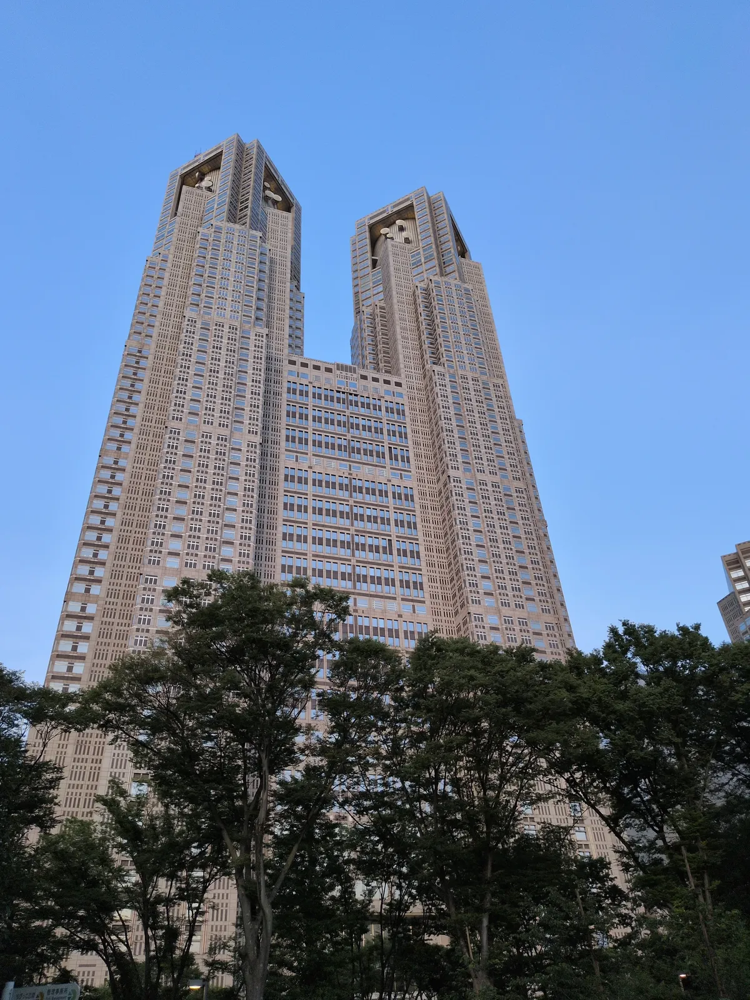
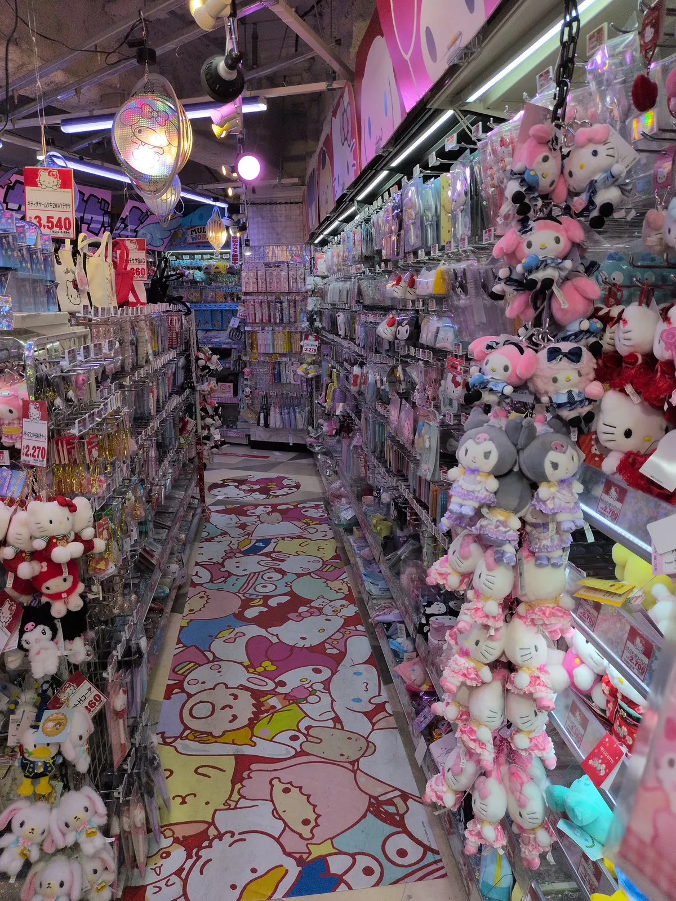
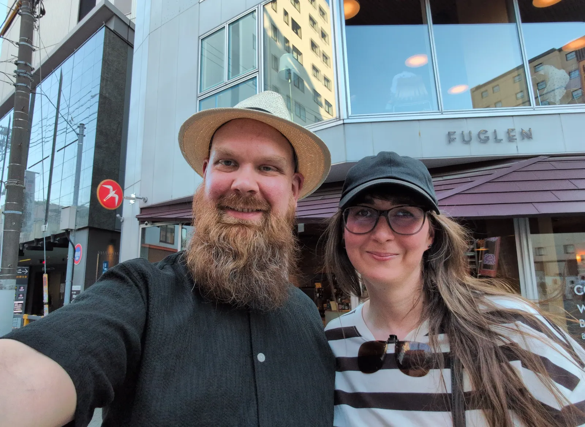
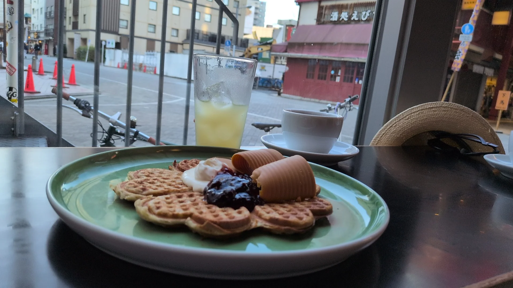
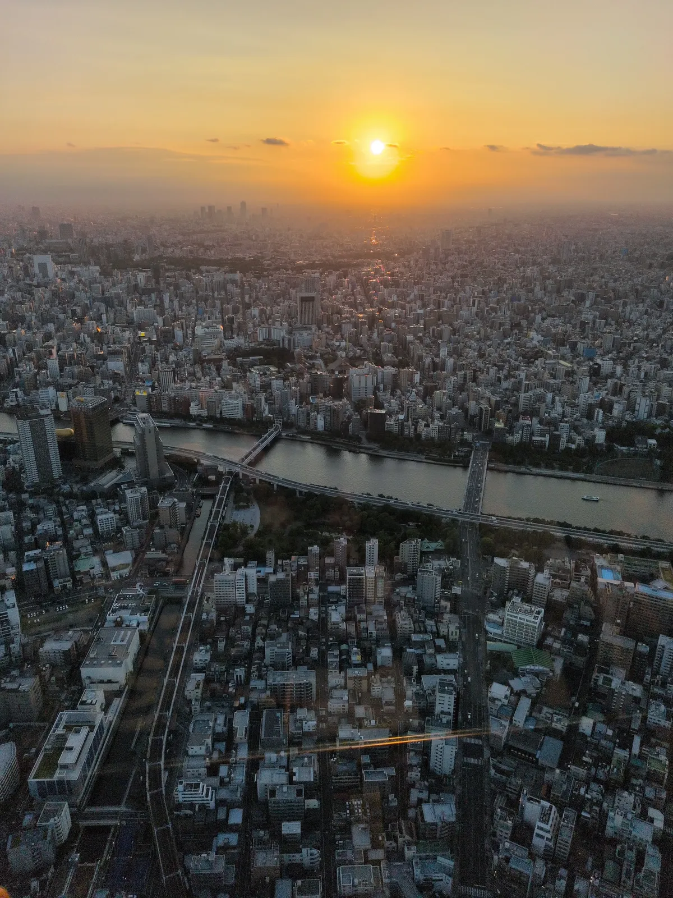
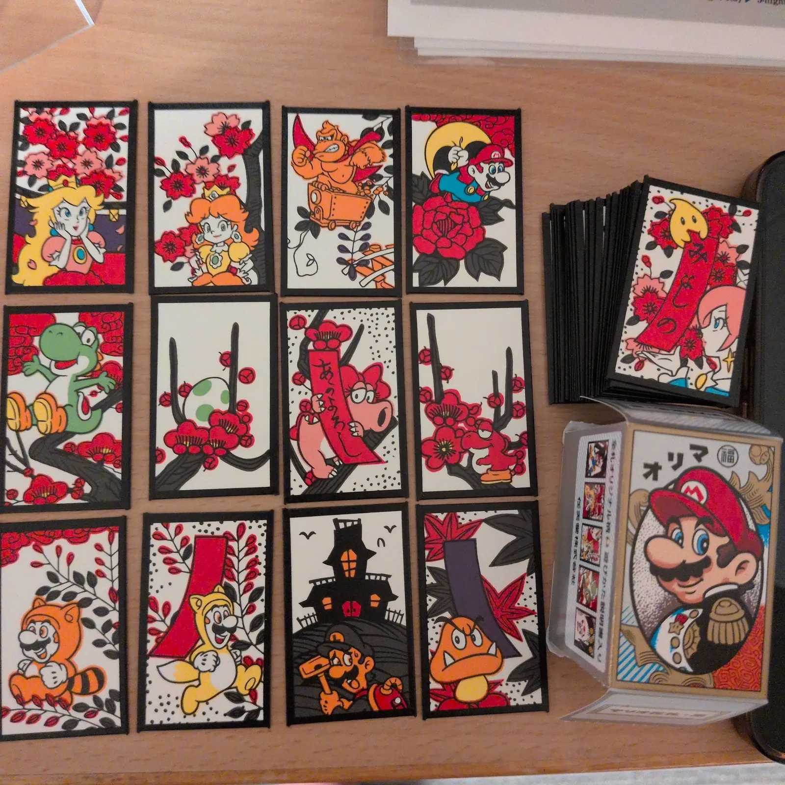

# Tokyo 2026

I juli 2026 besøkte jeg Tokyo. Det var mange inntrykk stappet sammen i en liten uke. Her kommer en liten smakebit.

---

#

Den grunnleggende planen for å oppleve mest mulig av Tokyo, var enkel og solid: Hver dag delte vi opp i tre:

- Dagstur.
- Siesta på hotellet.
- Kveldstur.

Så hver dag tok vi t-banen, toget eller beina fatt til en bestemt bydel, utforsket den, spiste lunsj. Deretter dro vi tilbake til hotellet, når dagen var på det varmeste, og slappet av og sov en liten time. Så dro vi ut igjen på kveldstid, for middag og for å oppleve den neon-belyste helsprø byen på sitt beste.

Nedenfor følger en oversikt over hver bydel vi besøkte, og de butikkene/restaurantene som ga best inntrykk. Jeg har også markert hvorvidt vi besøkte bydelen på dagtid eller kveldstid (noen ganger ble det begge deler, for ekstra utforskning).

---

## **Shinjuku** (dagtid)

Her lå hotellet, så alt vi fant på i Shinjuku, inklusive Kabukicho, lå i en gangavstand unna.

### Yellow Submarine ([Google Maps](https://maps.app.goo.gl/msbSgvCUK2ktKciY6))

Som mye annet er denne litt vanskelig å finne, men de har et stort utvalg av brukte spill, bøker, samlekort og samlefigurer. Så og si alt er på japansk, men det er allikevel verdt turen innom for å browse. Du kan også besøke <a href="https://yellowsubmarine.co.jp/shop/shinjuku/">hjemmesiden til Yellow Submarine Shinjuku</a> for mer informasjon.

### Book-Off ([Google Maps](https://maps.app.goo.gl/psGJEhGgXP982WYz9))

Fire etasjer med brukte bøker, leker, samlekort, samlefigurer, spill, anime, små-elektronikk, med mer. I likhet med Yellow Submarine, og alle andre bruktbutikker vi var innom, var også alle gjenstandene i perfekt form. I Japanske bruktbutikker plasserer de hvert eneste blad og manga-bøker i separate plastlommer.

### Shinjuku Chūō Park ([Google Maps](https://maps.app.goo.gl/5Ev2gh76wR6zet1U9))

Dette er ikke noen spektakulær park, men vi besøkte ikke så mange av parkene. Viktig å huske på: I de fleste parker skal man ikke sykle, og man burde holde seg rolig. Tokyo er en stressende by, og parken er et sted for avslapning. Jogging ser ut til å være greit, og denne parken har også en egen del hvor det spesifikt er lov til å stå på rulleskøyer/skate.

### Tokyo Metropolitan Government Building ([Google Maps](https://maps.app.goo.gl/t5QdPELKJsUeuo5A9))

En gigantisk bygning, som blir til to tårn/skyskrapere. På kveldstid kan de ha Pokemon-lysshow på veggen, og på dagtid kan du besøke observatoriet på toppen, 242 meter over bakken. Dette var den høyeste bygningen i Tokyo, frem til 2007.

## Kabukicho (kveldstid)

Dette er det berømte underholdningsdistriktet, men passer også til shopping. På kvelden blir underholdningen her litt mer voksenorientert, med mange innkastere som gir løfter om gode stunder – ignorer dem.

### Godzilla Head ([Google Maps](https://maps.app.goo.gl/eP6sEvBo66r173Ka9))

Det er vanskelig å besøke Kabukicho uten å se dette hodet, og det er egentlig ikke "anbefalt" som sådan. Men, det er noe sært å ha vært innom bydelen _uten_ å ha fått med seg Godzilla-hodet.

### Don Quijote Shinjuku Kabukicho ([Google Maps](https://maps.app.goo.gl/ysY9uC8jCkkpRDn76))

Jeg tror dette er en av de større Don Quijote-butikkene. Den er uansett stor nok. Hvordan skal man forklare Don Quijote? Det er vanskelig å oppsummere i ett ord. De har figurer, leketøy, kosmetikk, snop, suvenirer, ladere. Trenger du lader til elektronisk utstyr som passer i stikk-kontakten på hotellet, får du kjøpt den til en rimelig pris her. Hvis du fikk dilla på Godzilla, etter å ha sett hodet hans, har de masse Godzilla-merch, figurer, t-trøyer og magneter. Ikke forlat Don Quijote uten å ha tatt med deg et eksemplar av Don Don Donki i plysj!

### GODZ ([Google Maps](https://maps.app.goo.gl/HZHrERjgWbqRr8sE8))

En metall-pub. Sjekk ut [hjemmesiden](https://en.metal-godz.com/) for mer. Ikke mange sitteplasser her, men er det fullt kan man bare prøve igjen litt senere.

### BAR PSY ([Google Maps](https://maps.app.goo.gl/fUBXzHNaLyFrkPBY7))

Enda en metall-pub! Stemningen var veldig god her. Enda mindre sitteplasser enn på Godz, men god stemning!

## Asakusa (dag og kveld)

Vi dro til Asakusa tidlig, for å oppleve Shinto-buddhist-tempelet, og spise vaffel med brunost på Fuglen. På kvelden dro vi opp til Sky tree (forhåndsbestilte billetter er anbefalt), og så på at solen gikk ned over Tokio, 450 meter oppe i luften!

### Sensō-ji ([Google Maps](https://maps.app.goo.gl/UxptsEYD3hnFMgiv8))

Man burde besøke minst en rød port og ett tempel når man besøker Japan. Og denne har sine fordeler. Et stilig fem etasjers pagoda, en stor rød port (og noen mindre røde porter rundt omkring). Få også med deg Nakamise handlegata utenfor tempelet!

### Fuglen Asakusa ([Google Maps](https://maps.app.goo.gl/QVRpn891LZDQaRCW6))

Det er jo morsomt at kaffestua fuglen har filian i to byer: Oslo og Tokyo. Jeg tror de har to filialer i Tokyo nå, faktisk. Gå hit for å få i deg en skikkelig god norsk vaffel, med ekte norsk brunost!

### Tokyo Skytree ([Google Maps](https://maps.app.goo.gl/BcqzfabpT5WQMYd27))

450 meter opp i lufta. Her må man gå. Prøv å book en billett som er rundt solnedgang. Det er folksomt! Men folkemengder har de kontroll på i Tokyo, det går glatt unna. På bildet ser du solnedgang over Asakusa.

### Shopping Center Skytree ([Google Maps](https://maps.app.goo.gl/Fw3Pxz5brLEpgF5a6))

Har man først tatt turen, kan man like gjerne besøke kjøpesenteret under Tokyo Sky Tree etterpå. De har et Pokemon Center her med unik mynt, for de som er interesert i slikt. Vi spiste middag har denne i kvelden, i en beleilig food court.

## Jimbocho (dagtid)

Jimbocho er bydelen for bruktbøker og Ukiyo-e prints. De har også en egen karuta-butikk, for å kjøpe ekte karuta-kort.

### Yamada Shoten ([Google Maps](https://maps.app.goo.gl/Pehn5ZMRvtn2PKD28))

Det er mange butikker hvor man kan kjøpe Ukiyo-e prints. Vi valgte denne rett og slett fordi den åpnet litt tidligere enn andre butikker (10:30), som gjorde at vi fikk mer tid til å utforske Jimbocho.

### @Wonder JG ([Google Maps](https://maps.app.goo.gl/eAn8gLJD7hA5CShQ6))

@Wonder er en av mange bruktbokbutikker i Jimbocho, men det som gjør denne spesiell er at den har en stor avdeling dedikert til tegneserier på engelsk! Så hvis du er like glad i tegneserier som meg, går du innom her.

### Kitazawa Bookstore ([Google Maps](https://maps.app.goo.gl/7YvzFYNyaKW4Hr7r9))

Enda en butikk for brukte bøker, det spesielle her er nettop at de har bøker på engelsk. Her er det også lov å fotografere, og bla i bøkene! Begge deler er ofte ikke lov i butikker i Tokyo. Kitazawa hadde også fine samlinger med postkort, med stemplede frimerker, og noen Ukiyo-e prints hadde de også.

### Okuno Karuta Shop ([Google Maps](https://maps.app.goo.gl/nHUxNbqapdrEKyqM8))

Her må man nesten ta turen innom. Jeg kjøpte to kortstokker, en med klassiske motiver, og en med Super Mario-motiver, men i samme stil som Nintendo hadde i spillkortene som de førte på 1800-tallet.

### Ebimaru Ramen ([Google Maps](https://maps.app.goo.gl/4UhqYC43SfXmYEvF8))

Dette stedet tipset naboen våres om. Hummer-basert nudelsuppe ble rett og slett lunsjen vår, dagen vi besøkte Jimbocho.

## Odaiba (kveldstid)

Odaiba er en kunstig øy, med flere kjøpesentre og noen severdigheter, så som en tro kopi av Statue of Liberty, og Unicorn Gundam: En statue som beveger på seg, og serverer lys-show på angitte tidspunkter.

### Statue of Liberty ([Google Maps](https://maps.app.goo.gl/45Jkt2v97nXBvbfK6))

En liten versjon av Statue of Liberty.

### Stone Market ([Google Maps](https://maps.app.goo.gl/4AnkHmZyJZ3inYnNA))

Bare en liten butikk som selger smykker, naturlige steiner, krystaller tilbehør, etc. Og også godteri!? Veldig fornuftige priser, og jeg fant en veldig kul ring som jeg har brukt hver dag siden jeg var der.

### Unicorn Gundam ([Google Maps](https://maps.app.goo.gl/Jmti6DonbE2ETAxu5))

Dette er en gigantisk hvit statue/robot, som har ulike shows spesifikke tider på døgnet. Den beveger på seg, skifter farge, og man ser litt Gundam-tegneserie projisert på veggen bak den. Vi kom tilfeldigvis når et show startet, enten på grunn av ren flaks, eller fordi de sender slike shows ofte!

### Observation deck at Odaiba Seaside Park ([Google Maps](https://maps.app.goo.gl/FubHAtTBvuEWuVTi8))

Dette er et fint sted å stå for å se lys- og fonteneshow på kveldstid. I tillegg er det rett ved siden av den lokale tro kopien av Lady of Liberty.

## Akihabara (dag og kveld)

Enhver nerd/otaku/weeb som besøker Tokyo, er selvfølgelig innom Akihabara! Her finner du alt av waifu-dukker og puter, Pokemon-kort og merch, retrospill, arkadehaller, med mer. Her er det nok av butikker som spesialiserer seg på alt hva en ekte otaku kan ønske, og mer!

### Honey Toast Cafe ([Google Maps](https://maps.app.goo.gl/KBfMU9n4PFemE67X8))

Vi spiste frokost her. Det er ikke anbefalt. Hvit loff, krem, sirup og iskrem. Men! Det var en veldig morsom opplevelse, og må absolutt oppleves.

### 2k540 Aki-Oka Artisan ([Google Maps](https://maps.app.goo.gl/HYzGCrx3HktPLvLNA))

Dette stedet ligger under en jernbanelinje, og består av mange titalls butikker som selger håndlagde gjenstander. Her får du kjøpt unike håndlagde gjenstander, så som spisepinner, porselenskåler, klær, vesker, kunst. Det er også en som lager hjemmelagde klokker! Jeg hadde veldig lyst på en klokke, men vi endte opp i hvert fall med noen veldig stilige spisepinner og en minivase til kattenes værhår.

Hvis du først er innom 2k540: Prøv å fortsett oppover langs med jernbanen, så finner du etter hvert hundrevis av små og store butikker, som selger alt mulig rart. Enkelte av butikkene har dog pågående selgere, og disse har gjerne litt stive priser i tillegg.

### Mandarake Complex ([Google Maps](https://maps.app.goo.gl/BY32agvYTyumWFZ4A))

Det er flere Mandarake-filialer i Tokyo, og det er absolutt verdt å dra innom. Vi var innom flere, og jeg husker virkelig ikke hvem som var hvem. De har alt mulig av brukte manga-bøker, samlefigurer, retro-spill, CDer, vinyler, bamser, you name it. De har også gjenstander som kun egner seg for voksne, uten at avdelingen for dette er tydelig merket, så er du advart!

## Shibuya (dag og kveld)

Shibuya er en handelssenter i Tokyo, og er nok mest kjent for Shibuya-krysset. Har du sett filmer av tusenvis av japanere (og turister) som venter på at lyset skal bli grønt, for dereter at absolutt hele lyskrysset (alle kjøreretninger) blir grønt for gående trafikanter samtidig, og overfylles av mennesker - da ble nok videoen filmet nettop på Shibuya-krysset. Dessverre måtte jeg over dette krysset hele fire ganger selv i løpet av ferien, ikke anbefalt.

### Torch Torch ([Google Maps](https://maps.app.goo.gl/LjgmvkA8ChWGM9Qt5))

Her selger de spesifikt merch for spillene til From Software, altså Dark Souls, Elden Ring, Sekiro. Når jeg var innom, så jeg bare t-skjorter og smykker. Selv om det selvfølgelig er fristende å eie smykker som er tro kopier av in-game smykker fra Dark Souls, endte jeg opp med to t-trøyer.

### Tower Records Shibuya ([Google Maps](https://maps.app.goo.gl/AL5ZFPmKTzMycind7))

Sammen med Tower Records Harajuku (som jeg ikke var innom), er dette en av de større filialene. Absolutt verdt turen om du liker musikk, så klart! Jeg endte opp med å kjøpe CDer fra mine japanske favoritter: Hanabie, Broken by the Scream, Unlucky Morpheus og selvfølgelig Baby metal. En fin Tokyo Vinyl trøye ble det også på meg (selv om den eneste vinylen jeg kjøpte der, ble en Cyberpunk 2077-vinyl, simpelthen fordi den var så billig i forhold til å bestille den på nett i Norge).

## Ueno (dagtid)

Ueno er en park med mange museer. Vi var bare innom et av museene. Men i Ueno-parken er det eventer og festivaler fra tid til annen, så [sjekk agendaen](https://www.magical-trip.com/media/ueno-list-of-events-festivals-for-2025/)! Enten om du vil unngå dem, eller delta. :-)

### National Museum of Nature and Science ([Google Maps](https://maps.app.goo.gl/QAVu2kDjnLnSKyLu9))

Dette museet har en solid samling dinosaur-skjelletter, om du liker denslags. Et imponerende stort rom med utstoppede pattedyr også (eller var det naturtro figurer?). De har også utstillinger som viser apparater forskere benytter for å utforske naturen og verdensrommet, men jeg var der nok mest for dinosaurskjelletter selv!

Hvis du heller vil oppleve japansk og asiatisk kultur, burde du sikkert tatt turen innom nasjonalmuseet i stedet (som har flere store bygninger og nok krever en hel dag i seg selv, om du skal se alt). Ueno har også en dyrehage (med pander), kunstmuseer, med mer.
